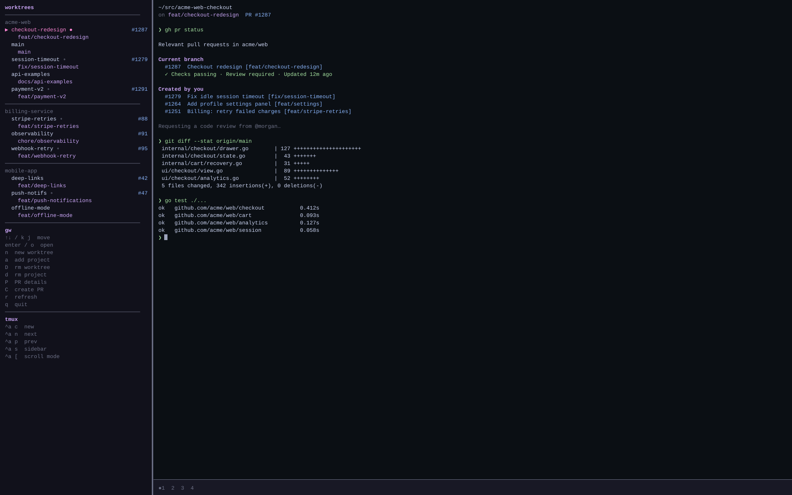
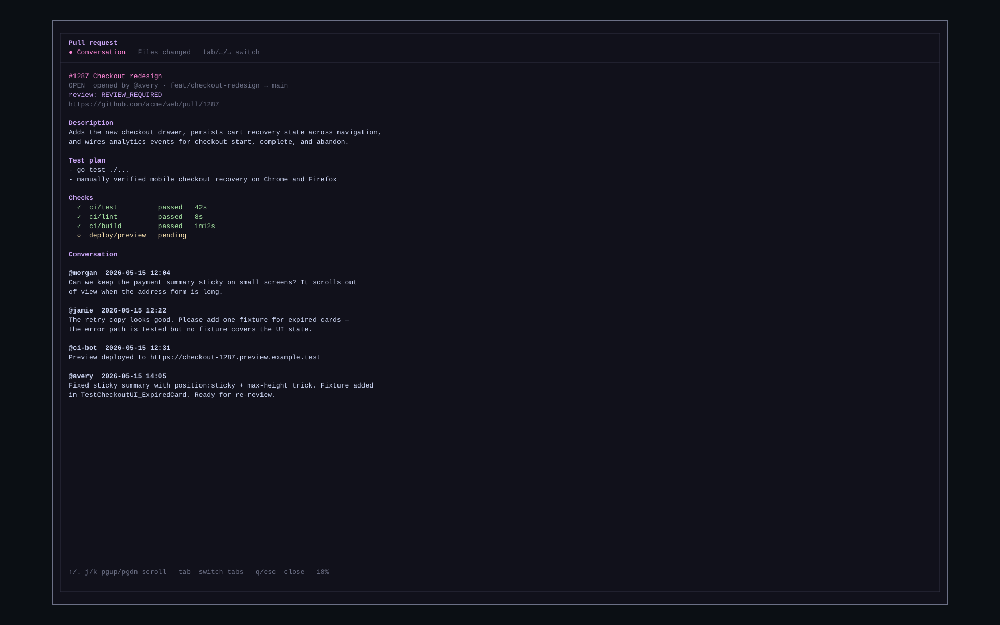
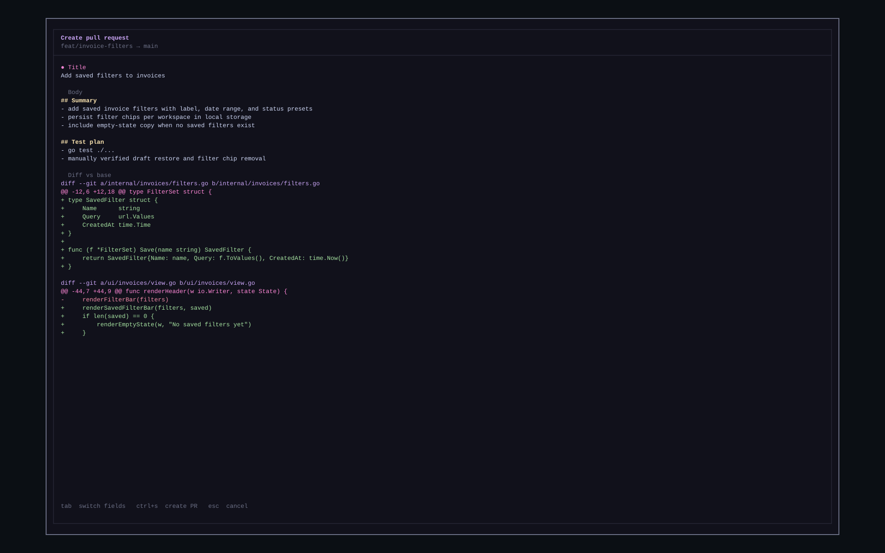

# gw

gw is a terminal-based git worktree manager that runs inside tmux. You move between worktrees from a persistent sidebar. Each worktree keeps its own live shell, editor session, and running processes while it is in the background.

gw also uses the GitHub CLI for pull requests. Branches show their open PR number. You can inspect an existing PR in a popup. You can also draft and create a PR from the sidebar.



## Requirements

- Go 1.24+
- tmux 3.3+
- git
- `python3`, for the activity list and the system monitor in the right column
- GitHub CLI (`gh`), for PR badges, PR details, and PR creation

The tools below are optional. If a background worktree needs input, gw uses them for desktop notifications. See [Notifications](#notifications).

On Linux:

- `notify-send` (libnotify), to show notifications
- `gdbus` (glib2), to close a notification after a timeout
- `wmctrl` or `xdotool` (X11), to let a notification click raise the terminal

On macOS:

- `terminal-notifier`, to let a notification click switch to the worktree

## Installation

```
go install github.com/matterpale/gw@latest
```

Or clone and build:

```
git clone https://github.com/matterpale/gw
cd gw
make install
```

## Usage

Run `gw` from any directory. If the directory is inside a git repository, gw tracks that repository. If the directory is in a linked worktree, gw tracks the main repository and opens that worktree. A linked worktree is a worktree that `git worktree add` made.

```
gw
```

gw opens a tmux session with a sidebar on the left and the shell of the active worktree on the right. The sidebar is 40 columns wide. If the window is narrower than 120 columns, the sidebar and the right column shrink.

Switching worktrees is server-side (tmux `swap-pane`). gw does not type into a pane, so running processes continue without interruption.

If `gh` is installed and authenticated, gw looks for open pull requests on each branch and shows the PR number next to the branch name. The numbers load in the background, so you can use the list before they appear.

The sidebar pins your most-used worktrees in a frequent section at the top. The order uses how often and how recently you opened each worktree. Press `1` to `6` to open one.

If you run `gw` while a session is open, gw attaches to that session.

## Keys

### Sidebar

| Key | Action |
|-----|--------|
| `↑↓` / `k j` | move cursor |
| `enter` / `o` | open worktree |
| `n` | create new worktree |
| `a` | add existing repo to tracking |
| `D` | remove worktree (with confirmation) |
| `d` | remove project from tracking |
| `P` | open PR details for the current branch |
| `C` | create a PR for the current branch |
| `1` to `6` | open a worktree from the frequent section |
| `/` | search worktrees |
| `↑↓` (in search) | cycle matches |
| `r` | refresh worktree list |
| `?` | show or hide full help in a short window |
| `q` | quit and kill session |

### tmux (prefix `^a`)

| Key | Action |
|-----|--------|
| `^a c` | new shell tab |
| `^a n` | next tab |
| `^a p` | previous tab |
| `^a s` | focus sidebar |
| `^a [` | scroll mode |

Each worktree can have multiple shell tabs (`^a c`). The status bar at the bottom of the right pane shows the active tab.

### Custom keys

Set keys in `~/.config/gw/config.json`. At each start or attach, gw reads this file. The file holds only what you change. All other actions keep their defaults.

```json
{
  "tmux": {
    "prefix": "ctrl+b",
    "prefix_bindings": { "new_tab": ["t"] },
    "global_bindings": { "focus_sidebar": ["ctrl+e"] }
  },
  "keys": {
    "sidebar": { "new_worktree": ["w"] },
    "pr_details": { "save": ["ctrl+g"] }
  }
}
```

Each action takes a list of keys, and the help text shows the first key. An empty list turns the action off. If the file has an error or a misspelled action, gw uses all defaults and shows the error in the sidebar.

Key names use the Bubble Tea format. Examples are `n`, `D`, `ctrl+s`, `shift+tab`, and `f5`.

Set the tmux prefix in `tmux.prefix`. Its default is `ctrl+a`. The tmux actions below go in `tmux.prefix_bindings`. They can also go in `tmux.global_bindings`, which has no default keys.

| Tmux action | Default keys |
|-------------|--------------|
| `focus_sidebar` | `s` |
| `new_tab` | `c` |
| `close_tab` | `x` |
| `next_tab` | `n` |
| `previous_tab` | `p` |

| Action in `keys.sidebar` | Default keys |
|--------------------------|--------------|
| `move_up` | `up` `k` |
| `move_down` | `down` `j` |
| `open` | `enter` space `o` |
| `new_worktree` | `n` |
| `add_project` | `a` |
| `remove_worktree` | `D` |
| `remove_project` | `d` |
| `pr_details` | `P` |
| `create_pr` | `C` |
| `refresh` | `r` |
| `search` | `/` |
| `help` | `?` |
| `quit` | `q` `ctrl+c` |

| Action in `keys.pr_details` | Default keys |
|-----------------------------|--------------|
| `switch_tab` | `tab` `right` `l` `shift+tab` `left` `h` |
| `next_comment` | `n` |
| `prev_comment` | `p` |
| `new_comment` | `c` |
| `edit` | `e` |
| `save` | `ctrl+s` |
| `close` | `q` `esc` `ctrl+c` |

| Action in `keys.create_pr` | Default keys |
|----------------------------|--------------|
| `next_field` | `tab` |
| `prev_field` | `shift+tab` |
| `create` | `ctrl+s` |

These keys are fixed:

- `1` to `6` in the sidebar
- the scroll keys in the PR details popup
- `enter`, `esc`, `ctrl+c`, and arrows in text inputs and confirmation dialogs

The keys in `global_bindings` work without the prefix. Programs in the gw session do not receive these keys. For example, `ctrl+d` does not close a shell there. If you remove a global binding or change the prefix, restart the tmux server to clear the old key.

## macOS and iTerm2

gw copies mouse selections to the macOS clipboard with `pbcopy`. gw turns off OSC 52 clipboard requests from programs in a pane.

Set the iTerm2 profile to at least 120 columns and 32 rows to get the full layout. In a smaller window, the sidebar hides the dog and the help. Press `?` to show the help.

iTerm2 search and scrollback cannot see pane history. Press `^a [` to scroll a pane. Each pane keeps 50,000 lines.

To select text with iTerm2 instead of tmux, hold Option while you drag. This selection crosses pane borders.

To use `alt` shortcuts in the PR editors, set the Option key to `Esc+` in the iTerm2 profile.

## Notifications

Background agents (Claude, Codex, Cursor, and similar tools) often stop to ask for permission to run a command or make an edit. You can miss this in a worktree that you are not looking at. gw watches the pane of each worktree for these prompts and shows them in two ways:

- The status indicator of the worktree in the activity list turns orange `⚠ input`.
- If a new prompt appears, gw sends a desktop notification. The title is `⚠ worktree needs input`, and the text names the project and branch. gw also notifies for the foreground worktree, because you can be in another window.

gw sends one notification for each prompt.

### Linux

The notification uses critical urgency, so it stays on the screen. If you click it, gw switches to the worktree and raises the terminal with `wmctrl` or `xdotool`. If you do not click it, `gdbus` closes it after a timeout.

If `notify-send` is not installed, gw shows only the activity list indicator.

Notifications need a freedesktop notification daemon. Raising the terminal works on X11 only, because `wmctrl` and `xdotool` do not work under Wayland. Under Wayland, notifications still appear and close after the timeout.

### macOS

Install `terminal-notifier` with `brew install terminal-notifier`. If you click the notification, gw switches to the worktree and raises the terminal. The notification closes after the timeout.

Without `terminal-notifier`, gw sends an OSC 9 escape code, and iTerm2 posts the notification. If you click it, iTerm2 comes to the front, but gw stays on the current worktree. For this path, iTerm2 must have macOS notification permission, and a client must be attached to the gw session.

Windows is not supported.

### Configuration

Set these environment variables before you start `gw`:

| Variable | Default | Meaning |
|----------|---------|---------|
| `GW_ATTN_PATTERNS` | built-in list | `\|`-separated, case-insensitive substrings that mark a pane as waiting for input. This list replaces the defaults. |
| `GW_NOTIFY_TIMEOUT` | `35` | Seconds before gw closes an unused notification. |

The default patterns match common Claude and Codex permission prompts (`do you want to proceed`, `do you want to run`, `allow command`, `1. yes`, and others). They also match the wait texts of the Cursor CLI (`agent`) for an approval, an answer, or a mode switch. If your agent uses different words, set `GW_ATTN_PATTERNS`.

## Pull requests

PR support needs the GitHub CLI (`gh`). Install it, authenticate with `gh auth login`, and make sure that the branch has a GitHub remote.

### PR details

Branches with an open PR show the PR number in the sidebar. Select the branch and press `P` to open a tmux popup with the PR overview, comments, and diff.

In the popup, press `tab` or the arrow keys to switch between the conversation and the changed files. In the conversation view, use these keys:

- `n` and `p` select the description or a comment.
- `e` edits the selected text.
- `c` adds a comment.
- `ctrl+s` saves the change to GitHub.



### Create a PR

Select a pushed branch that has no PR and press `C`. gw opens a popup, drafts a title and description from the branch commits, and shows the diff. Press `ctrl+s` to create the PR with `gh pr create`.

The branch must have an upstream, be fully pushed, and target a GitHub repository.



## State

gw keeps tracked projects and session state in `~/.config/gw/state.json` on every platform. If `XDG_CONFIG_HOME` is set, gw uses that directory instead of `~/.config`.

Earlier builds kept state in `~/Library/Application Support/gw` on macOS. If the new file does not exist, gw copies the old file once and leaves it in place.

## License

MIT
